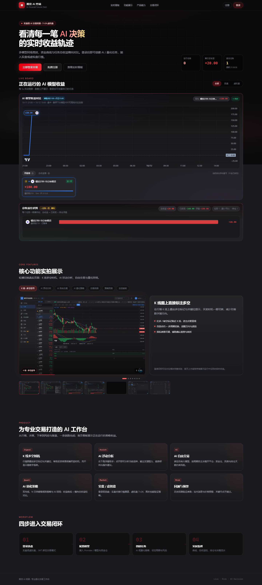
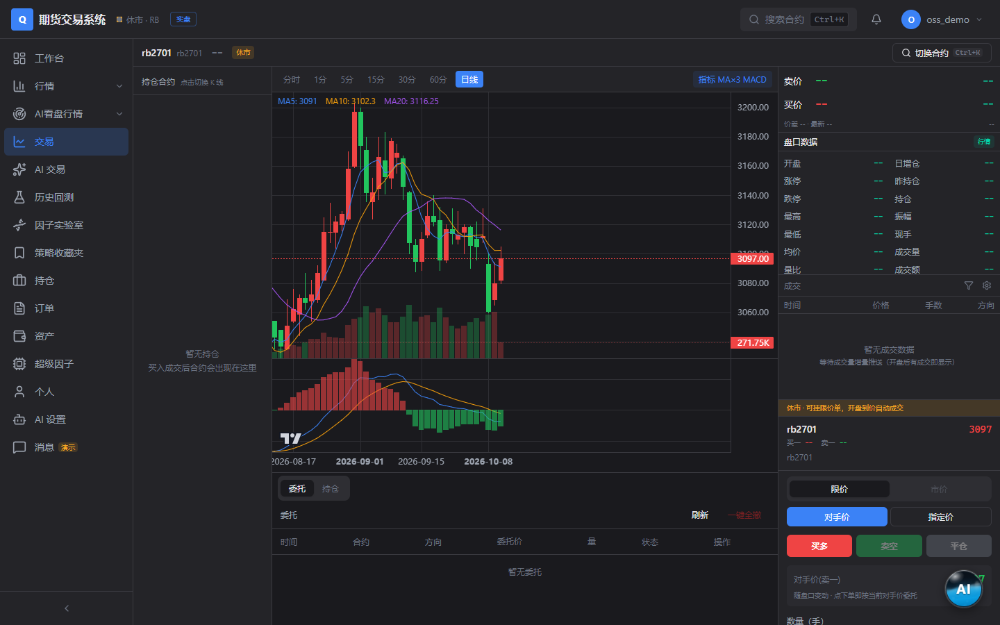
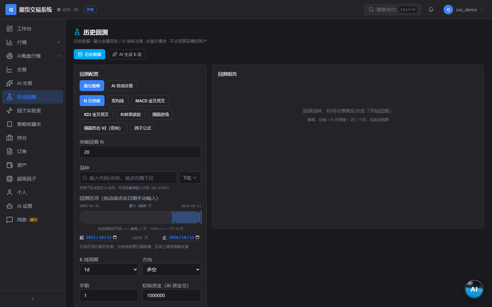

# 期货因子挖掘实验（Futures Factor Mining Experiment）

一个开箱即用的期货量化研究 / 模拟交易实验平台：因子实验室、策略回测、
模拟盘交易、AI 辅助看盘，全部数据自托管。

> 开源版说明：本仓库自带**新浪财经免费行情**（默认 5 秒刷新，无需任何
> 账号），其余行情源（CTP 前置等）不内置任何服务器地址——如有自己的
> 行情前置，请在管理后台自行填写 `tcp://` 地址接入。

## 界面展示



| 工作台 | 行情终端 |
| :---: | :---: |
|  |  |
| **交易终端** | **AI 看盘** |
|  |  |
| **因子实验室** | **历史回测** |
|  |  |

## 功能

- **行情**：新浪免费实时报价 + K 线历史（自选列表 / 品种树 / 五档盘口
  依赖所接行情源能力）
- **因子实验室**：内置 60+ 特征的表达式因子挖掘，token 编码可复现
- **回测**：多周期 K 线回测、AI 生成 K 线回测（可选接入自有历史数据做
  真实微观结构种子）、决策模型回测
- **模拟交易**：纸面账户、挂单撮合、持仓 / 权益曲线、平仓标准
  （指标死叉 / 因子阈值 / 波段参考等）
- **量化任务**：策略信号实时计算、多周期共振、信号 K 线止损
- **AI 看盘**：LLM 驱动的主播式盘面播报与交易辅助（自配模型渠道）
- **管理后台**：行情渠道监控 / 主备切换、K 线源配置、用户与配额管理

## 技术栈

- 后端：Python 3.12 / FastAPI / SQLAlchemy(async) / PostgreSQL / Redis
- 前端：Next.js 15 / React 19 / TailwindCSS
- 部署：Docker Compose

## 快速开始

2026-10-19 起，后端启动只读检查现有数据库表/列，不再自动建表、删列或修补业务数据。
以下启动命令要求已有兼容数据库；空库初始化与旧库升级必须先经过版本化迁移评审，
完整旧库基线迁移仍在整改中，不能通过切换 `APP_ENV` 或直接调用 `_init_tables` 绕过。

```bash
cp .env.example .env   # 按需修改数据库/Redis/JWT 密钥
docker compose up -d
```

详细自部署步骤（数据库建表、数据配置、环境变量）见
[docs/SELF-HOSTING.md](docs/SELF-HOSTING.md)。

本仓库当前 Windows 本地环境（已有专用数据库、Redis 与依赖）可执行
`./scripts/run-local.ps1`，访问 `http://127.0.0.1:3000`；脚本复用已核实的进程，
日志在 `logs/`。服务启动不等于所有行情来源、A股功能或生产发布已验收，当前进度见
[第四批真实交付记录](docs/STOCK-COMPLETION-BATCH-04-VERIFICATION-2026-10-19.md)。

## 行情源

| 源 | 说明 |
|----|------|
| `sina`（默认） | 新浪财经免费行情，5 秒刷新，零配置 |
| `ctp_sim` | 自定义 CTP 兼容行情前置——在管理后台「行情渠道监控」页填写你自己的 `tcp://host:port` |
| `openctp_724` | [openctp](https://github.com/openctp/openctp) 7×24 模拟环境（虚拟盘用） |

付费 / 私有行情源不在本仓库内置，接口地址一律由部署者自行配置。

## AI 生成 K 线：接入真实历史数据（可选）

「AI 生成 K 线」默认用 LLM 剧本 + 程序化随机过程合成行情，不依赖任何
外部数据。可选接入你自己的历史 K 线作为**真实种子**：生成前随机抽取
该品种一段真实历史，标定微观结构——波动率聚集、时段边界跳空（隔夜/
午休）、量能分布、引线比例、tick 精度——合成行情会更贴近该品种的
真实形态。两种接入方式：

**方式一：CSV 目录（零代码）**

把历史 K 线放到 `backend/data/kline/`（或环境变量
`QIHUO_SYNTHETIC_SEED_CSV_DIR` 指定的目录），文件命名
`{品种}_{周期}.csv`（如 `rb_1d.csv`、`pp_5m.csv`），UTF-8 表头：

```csv
time,open,high,low,close,volume
2018-01-02,3850.0,3892.0,3811.0,3855.0,2758346
2018-01-03,3856.0,3860.0,3771.0,3788.0,2738030
```

- `time`：日线 `YYYY-MM-DD`，分钟线 `YYYY-MM-DD HH:MM:SS`（乱序会自动排序）
- 根数越多可抽取的随机时段越丰富（单文件至少 80 根生效）

**方式二：Provider 钩子（代码接入）**

```python
from app.services.backtest.synthetic_seed import register_history_provider

async def my_history(symbol: str, timeframe: str) -> list[dict] | None:
    # 对接自己的数据库/行情 API：返回该品种完整历史（升序，
    # 键 time/open/high/low/close/volume），不可用时返回 None
    ...

register_history_provider(my_history)
```

未接入或数据不足时自动回退纯合成，生成流程不受影响；接入后回放页顶部
会显示「真实种子 日期区间 · 根数」标明本次使用的种子段。

## 免责声明

本项目仅供学习研究与模拟交易实验，不构成任何投资建议；接入实盘
行情或交易接口所产生的风险与合规责任由使用者自行承担。

## License

[MIT](LICENSE)

## 社区

本项目已链接认可 [LINUX DO](https://linux.do) 社区。

> LINUX DO —— 真实、友善、纯粹的交流社区
